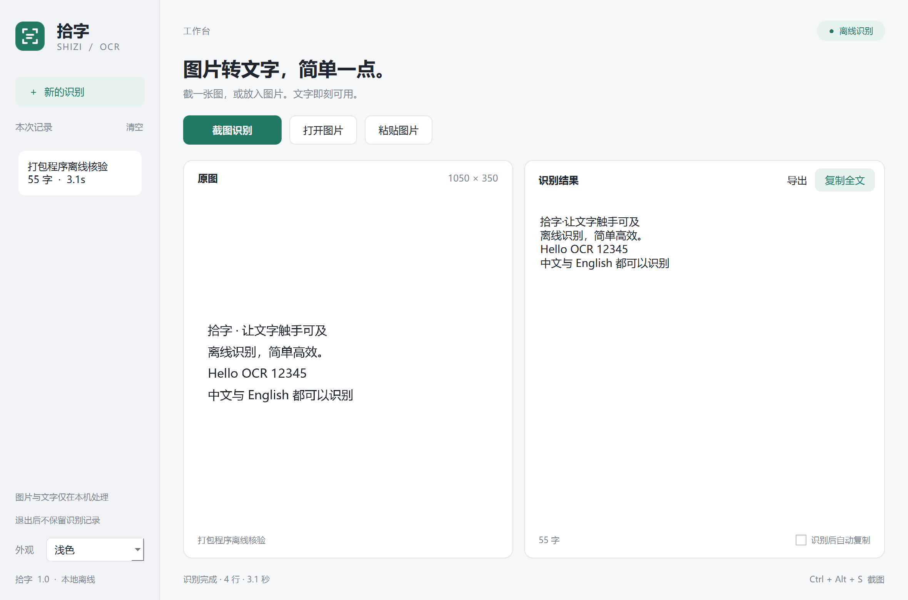
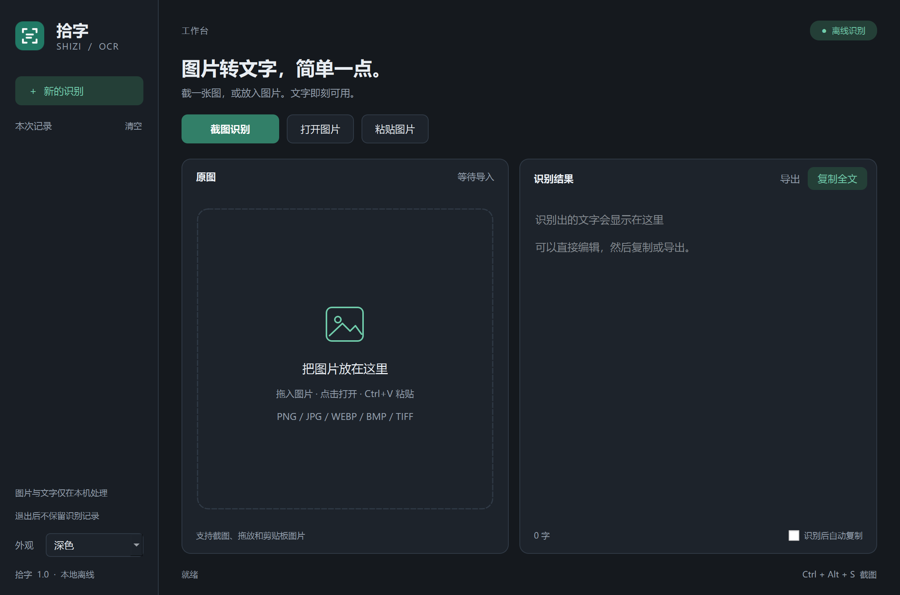

# 拾字 · Shizi OCR

一款极简的 Windows 离线文字识别工具。截图或放入图片，就能提取中英文，直接编辑、复制或保存。

[下载 Windows 便携版](https://github.com/taonian1989-hub/shizi-ocr/releases/latest) · [使用说明](docs/使用说明_v1.md) · [验收记录](docs/验收记录_v1.md)



## 开始使用

1. 在 [Releases](https://github.com/taonian1989-hub/shizi-ocr/releases) 下载 `shizi-ocr-v1.0.0-windows-x64.zip`。
2. 解压整个压缩包，进入「拾字」文件夹。
3. 双击 `拾字.exe`，点击「截图识别」，或按 **Ctrl+Alt+S**。

无需安装 Python，无需配置 API Key，无需联网下载模型。请保留 EXE 同目录下的全部文件。

## 核心功能

- **区域截图识别**：全局快捷键唤起框选，Esc 或右键取消。
- **图片识别**：打开、拖入或粘贴图片，支持多张排队；兼容 PNG、JPG、WEBP、BMP、TIFF 等格式。
- **编辑和输出**：原图与文字并排核对，结果可直接编辑、复制，或导出为 UTF-8 TXT。
- **本次记录**：切换本次识别结果，退出后清除，不写入历史数据库。
- **浅色与深色**：简洁工作台、系统字体和高 DPI 适配。



## 快捷键

| 快捷键 | 操作 |
| --- | --- |
| Ctrl+Alt+S | 全局区域截图 |
| Ctrl+O | 打开一张或多张图片 |
| Ctrl+V | 粘贴剪贴板图片；编辑框内支持普通文本粘贴 |
| Ctrl+Shift+C | 复制当前全文 |
| Ctrl+S | 导出当前结果为 TXT |

若全局快捷键被其他软件占用，状态栏会提示，仍可使用窗口中的截图按钮。关闭窗口即退出；最小化时仍可使用全局快捷键和托盘菜单。

## 运行环境与边界

当前版本为 **v1.0.0 / Windows 11 x64**，使用 CPU 推理，无需独立显卡。已在 Windows 11、200% 系统缩放下验证。界面最小尺寸为 960×640 逻辑像素。

识别以横排中英文为主。首版不包含 PDF、二维码、公式或复杂版面还原。表格、竖排、低清小字可能需要手动修订。多显示器按各屏缩放处理，单次选区限于一块屏幕；本版本尚未完成多显示器组合实机验收。

首次识别需要加载模型。一次会话最多 100 条记录；超过 4000 万像素的图片会提示裁剪，最长边超过 5000 像素的输入会缩小处理。

## 隐私

图片与文字在本机处理，不上传，不含遥测。记录默认只驻留内存，退出后不保留。只有主动导出才会保存文字。复制功能会将文字写入 Windows 剪贴板，其历史和同步行为由系统设置决定。

## 源码运行与构建

开发环境为 Python 3.14 / Windows 11 x64，GUI 使用 PySide6，识别使用内置 PP-OCR 模型与 ONNX Runtime。

```powershell
git clone https://github.com/taonian1989-hub/shizi-ocr.git
cd shizi-ocr
python -m venv .venv
.\.venv\Scripts\python.exe -m pip install -r requirements-lock.txt
.\.venv\Scripts\python.exe src\main.py
```

运行验收与打包：

```powershell
.\.venv\Scripts\python.exe tests\verify_app.py
.\.venv\Scripts\python.exe tests\verify_hotkey.py
.\build.ps1
```

关闭已有实例后运行快捷键验收，避免 Ctrl+Alt+S 被已有实例占用。`verify_app.py` 使用系统 `C:/Windows/Fonts/msyh.ttc` 字体生成中英文测试样张。首次安装开发依赖需要联网，之后运行与识别均可离线。

| 目录 | 内容 |
| --- | --- |
| `src/` | 应用源码 |
| `tests/` | 真实 OCR 与 Qt 交互验收 |
| `docs/` | 使用说明、截图、验收记录与许可证 |
| `work/` | 本地构建与验收中间文件，不提交 |
| `outputs/` | 打包程序与正式交付，不提交；发行文件通过 Releases 提供 |

`requirements-lock.txt` 记录本次发布的精确依赖。构建脚本限定 DLL 搜索路径，避免其他已安装工具的 ICU DLL 影响 Qt。完整交付包含可替换的动态 Qt 库及第三方许可。本机聊天下载副本仅作为交付镜像，属于运行环境规定的输出例外。

## 许可与致谢

应用源码采用 [MIT License](LICENSE)。第三方组件和模型遵循各自许可证，详见 [第三方说明](第三方说明.md) 与发行包 `licenses/`。

感谢 [Umi-OCR](https://github.com/hiroi-sora/Umi-OCR) 提供功能流程参考，以及 [RapidOCR](https://github.com/RapidAI/RapidOCR)、[PaddleOCR](https://github.com/PaddlePaddle/PaddleOCR)、Qt/PySide6 和 ONNX Runtime。本项目独立实现应用与界面，未复制 Umi-OCR 源码或图标。
